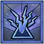
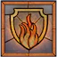
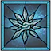
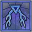
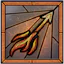

# Hawezar 

## World of Warcraft Forever released 2026-12-5

    시점은 마우스,이동은 adws
    어스름 사제:
    #showtooltip 상급 치유
    /cast [@mouseover,help,nodead][help,nodead][@targettarget,help,nodead][@player] 상급 치유
    // 아군(help),살아있다면(nodead)
    // 1순위 마우스오버,2순위 현재대상,3순위 적타겟의 대상
    필드퀘:  암흑에 정신력누출 5포,수양의 법봉 2포, 명상찍고 수양으로 쭉
        정분,고통하고 법봉질

    수양: 법봉(2),빛의힘(3) / 신성한 정밀함(1),정신력(4) / 명상(3),내면의집중력(1),보호막(1/3) / 내면의열정(3/3),보호막(3/3)
    암흑: 법봉(2),정신력누출(5/5),어둠의권능:고통연마(2/2),암흑마법집중(1/5),정신의 채찍(2/2),암흑마법집중(3/5)

## Diablo 4 Sorcerer Skills - Season 4

## Diablo 4 

[강령 입문가이드 절단 강령은 어케싸우나요](https://gall.dcinside.com/mgallery/board/view/?id=diablo4&no=142458)

[강령술사 이중 속성 궁극기 고찰](https://roomerkim.tistory.com/109)

[시즌4 미친 성능의 1티어 빌드! 암흑 마법학자](https://www.youtube.com/watch?v=5RCxZLn11sw)

[자격산사태](https://www.inven.co.kr/board/diablo4/6030/30342)

[출혈은 기본,메인스킬(소돌,도려,후려)은 선택](https://www.inven.co.kr/webzine/news/?news=297419&site=diablo4)

[쌍수 출혈후려](https://www.inven.co.kr/board/diablo4/6029/45282)

[도려내기 바바](https://www.inven.co.kr/board/diablo4/6029/47096)

[도려내기 야만 크리티컬딜러](https://www.youtube.com/watch?v=tfp9E8xOmbs)

[그라핀 원소술사 인벤](https://www.inven.co.kr/board/diablo4/6033/26444)

[우버 두리엘,안다리엘 소환법 PoEasy](https://www.youtube.com/watch?v=ctDVJntKOJo) 

[디아블로4 보스위치및 고행 200레벨소환 재료 플레잇](https://blog.naver.com/winsweet/223458332207) 

[CHAOSCUBE DIABLO4](https://www.chaoscube.co.kr/) 

[디아브로4 신규엔드게임 보스5종 및 드랍아이템 정보](https://www.chaoscube.co.kr/board/d4-ccbook/12105117) 

