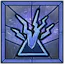
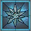
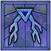
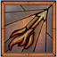

# Hawezar 

## World of Warcraft Forever released 2026-12-5

    시점은 마우스,이동은 adws
    어스름 사제/역병걸린 사제/
    #showtooltip 상급 치유
    /cast [@mouseover,help,nodead][help,nodead][@targettarget,help,nodead][@player] 상급 치유
    // 아군(help),살아있다면(nodead)
    // 1순위 마우스오버,2순위 현재대상,3순위 적타겟의 대상
    필드퀘:  암흑에 정신력누출 5포,수양의 법봉 2포, 명상찍고 수양으로 쭉
        정분,고통하고 법봉질

- 수양 15: 
    - 법봉(2)
    - 이중수양(3/5)
    - 신성한 정밀함(1/3),
    - 정신력(4/5) 
    - 명상(3/3)
    - 내면의집중력(1/1)
    - 보호막(1/3) 
    - 내면의열정(3/3)
    - 보호막(2/3)

- 암흑 32: 
    - 정신력누출(5/5)
    - 어둠의권능:고통연마(2/2)
    - 암흑마법집중(1/5)
    - 어둠의 테두리(1/2)
    - 정신분열연마(4/5)
    - 정신의 채찍(1/1)
    - 정신의 채찍연마(1/2)
    - 정신 분열 연마(4/5)
    - 암흑마법집중(0/5)
    - 어둠의 강화(5/5)
    - 흡혈의 선물(1/1)

[와우 포에버 요리 제조법](https://seemeta.com/ko/wow-forever/professions/cooking)

    긴주둥이진흙통돔구이 도안 - 모단호구 /아포/엘윈숲
    줄무늬고등어구이 도안 -모단호수/저습지/서부몰락/붉은마루
    훈제총명어 도안 - 스톰
    무지개날개다랑어: 서부몰락,저습지

### [던전](https://wowf.io/ko/dungeons#quests)

- 영주의 전당(13-16)
- 성난불길 협곡(13-16)
- 로데론의 페허(17)
- 죽음의 페광(18-21)
- 통곡의 동굴(19-22)
- 그림자송곳니 성채(23-26)
- 검은 심연의 나락(25-28)
    - 심연의지식(아포): 물속
    - 타락에 대한 연구(스톰->어둠의해안.아우버다인)
    - 타엘리드 찾기(던전안)
    - 황혼망치단의모락(다르나서스)
    - **검은심연의 음모**(던전안,*다르*에가서 *새벽감시자 섀드라스*_퀘 받기) - 마법봉(*묘비의홀*) 

- 스톰윈도 지하감옥(26-29)
    - 사필귀정(붉은마루)
    - 죄와벌(그늘숲)
    - 폭동진압(스톰)
    - 피의색(스톰)
    - 감옥폭동(스콤)
    - 격노
    - 모틀리가마슨(저습지.던모드르) - *검은무쇠 부족과의 전투*부터

- 발굴현장:저습지(28-31)
    - 고원가죽(저습지.메네실)
    - 고원의공포(저습지.녹지대)
    - 덤블 속 실종자(저습지.메네실)
    - 송블레이드수색(붉은마루)
    - 잃어버린유물수송(던전안)

- 달라란(30-33)
    - 녹빛표본(스톰)
    - 압도적인힘(스톰)
    - 분열의심장
        - 대마법사 모데라의 환영(은빛소나무) 연계
        - 사절 자크(힐스.사우스쇼어)
    - 비전에굶주린자들(은빛)

- 가시덩굴 우리(30-33)
- 놈리건(31-34)
- 붉은십자군 수도원 묘지(31-34)
- 붉은십자군 수도원 도서관(34-37)
- 가라앉은 도시(35-40)
- 붉은십자군 수도원 무기고(37-40)
- 가시덩굴 구릉(38-41)
- 붉은십자군 수도원 대성당(39-42)
- 크롤도크 보루(40-45)
- 울다만(44-47)
- 줄파락(45-48)
- 마라우돈(48-51)
- 알카즈 감옥(48-53)

## Diablo 4 Sorcerer Skills - Season 4

## Diablo 4 

[강령 입문가이드 절단 강령은 어케싸우나요](https://gall.dcinside.com/mgallery/board/view/?id=diablo4&no=142458)

[강령술사 이중 속성 궁극기 고찰](https://roomerkim.tistory.com/109)

[시즌4 미친 성능의 1티어 빌드! 암흑 마법학자](https://www.youtube.com/watch?v=5RCxZLn11sw)

[자격산사태](https://www.inven.co.kr/board/diablo4/6030/30342)

[출혈은 기본,메인스킬(소돌,도려,후려)은 선택](https://www.inven.co.kr/webzine/news/?news=297419&site=diablo4)

[쌍수 출혈후려](https://www.inven.co.kr/board/diablo4/6029/45282)

[도려내기 바바](https://www.inven.co.kr/board/diablo4/6029/47096)

[도려내기 야만 크리티컬딜러](https://www.youtube.com/watch?v=tfp9E8xOmbs)

[그라핀 원소술사 인벤](https://www.inven.co.kr/board/diablo4/6033/26444)

[우버 두리엘,안다리엘 소환법 PoEasy](https://www.youtube.com/watch?v=ctDVJntKOJo) 

[디아블로4 보스위치및 고행 200레벨소환 재료 플레잇](https://blog.naver.com/winsweet/223458332207) 

[CHAOSCUBE DIABLO4](https://www.chaoscube.co.kr/) 

[디아브로4 신규엔드게임 보스5종 및 드랍아이템 정보](https://www.chaoscube.co.kr/board/d4-ccbook/12105117) 

