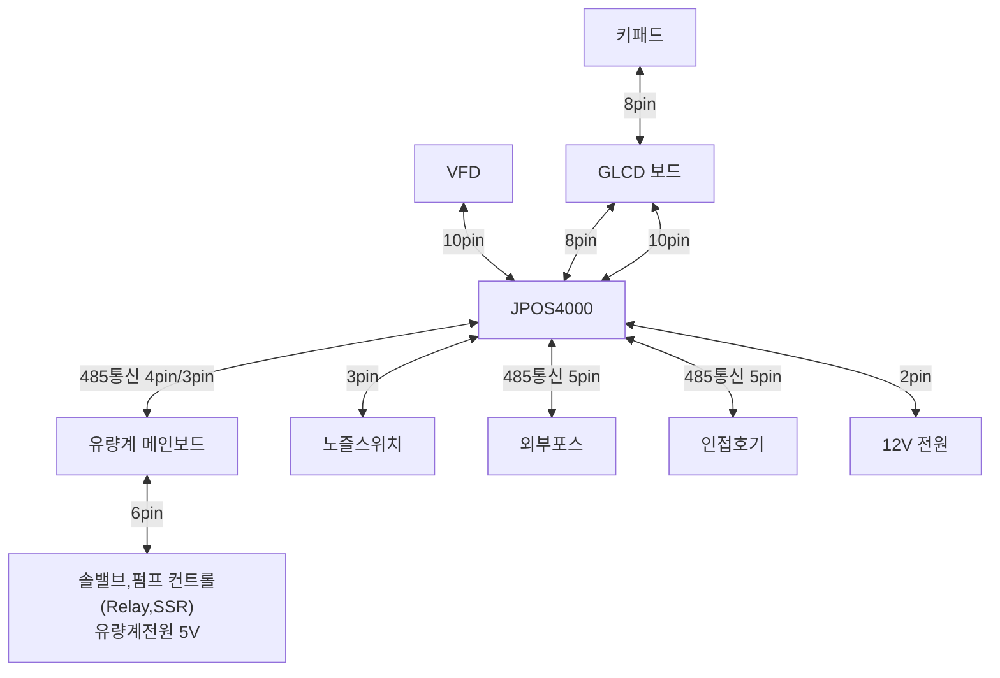

[md](https://markdowntoword.io/ko/tools/markdown-to-pdf)

## JPOS4000 테스트시 필요한 케이블 하네스

### 와이어 하네스(전선 양쪽끝에 2mm Female로 하우징)
- 2mm 8pin 와이어 하네스1개(키패드와 LCD보드연결)
- 2mm 8pin 와이어 하네스1개(LCD보드와 JPOS4000연결)
- 2mm 10pin 와이어 하네스 1개(LCD보드와 JPOS4000연결)
- 2mm 10pin 와이어 하네스 1개(VFD와 JPOS4000연결)
- 2mm 4pin 와이어 하네스 1개(JPOS4000(4pin)과 유량계메인보드연결(3pin))
- 2mm 5pin 와이어 하네스 1개(JPOS4000(5pin)과 외부 포스연결)
- 2mm 5pin 와이어 하네스 1개(JPOS4000(5pin)과 JPOS4000(5pin)연결)
- 2mm 3pin 와이어 하네스 1개(JPOS4000(3pin)과 노즐스위치연결)
- 2mm 6pin 와이어 하네스 1개(유량계메인보드연결(6pin)과 파워/쏠밸브모듈(6pin))
- 2.54mm 2pin 와이어 하네스 1개(JPOS4000(2pin) 12V 전원 )

